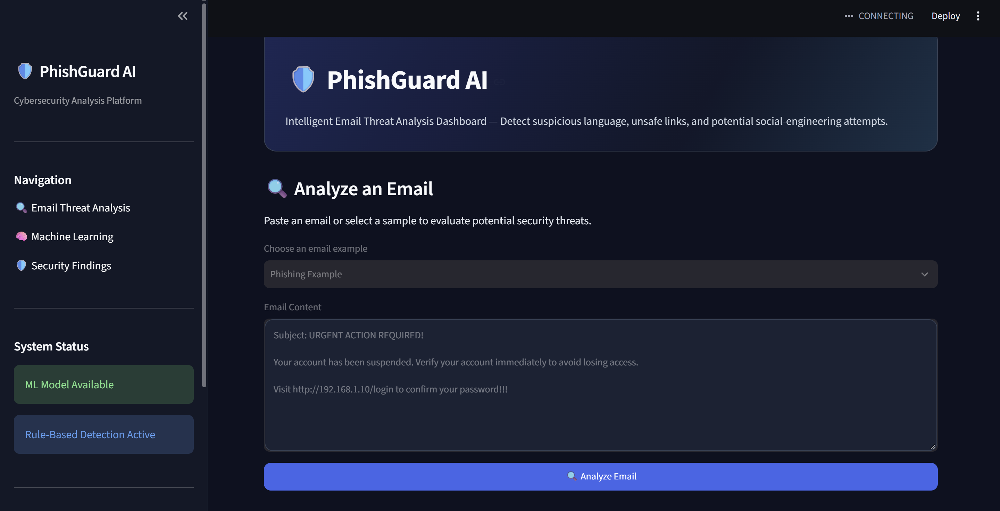
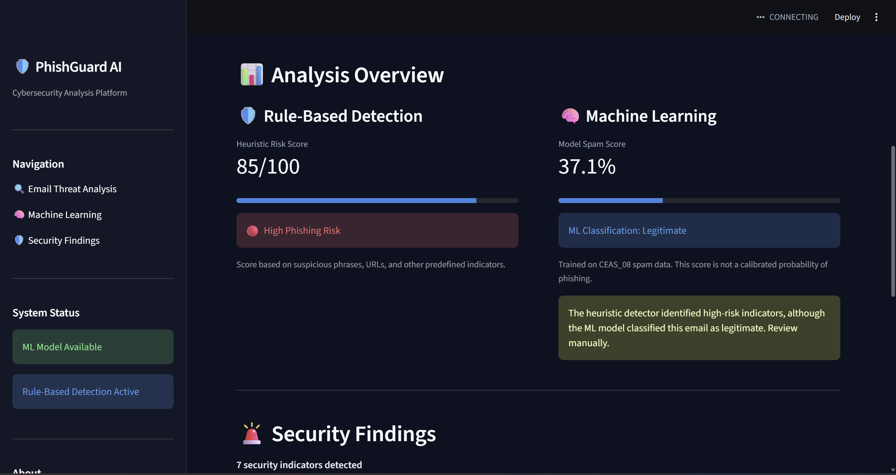
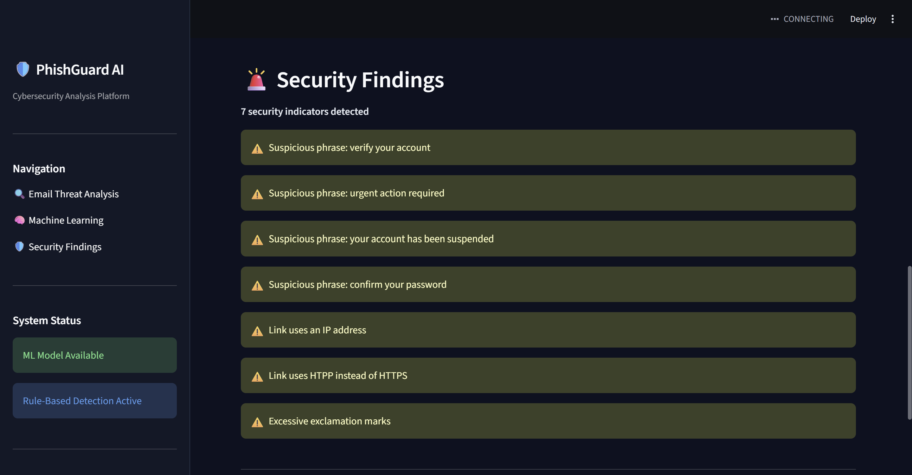
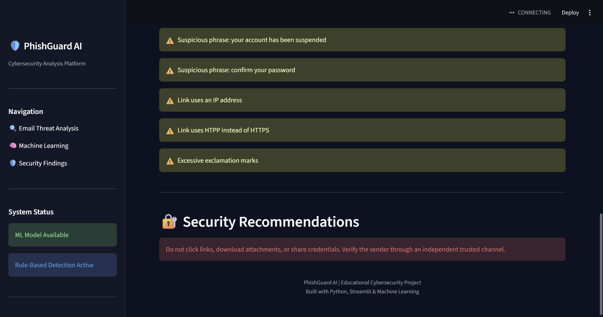

## PhishGuard AI

A Python-based cybersecurity application that analyzes email content to identify suspicious characteristics using rule-based security checks and machine learning.

The project combines traditional cybersecurity detection techniques with natural language processing to provide interpretable email risk assessments through an interactive Streamlit dashboard.

## ScreenShots




## Features

- **Email Analysis:** Analyze user-submitted email content.
- **Phishing Indicator Detection:** Identify suspicious language, urgency tactics, and credential requests.
- **URL Inspection:** Flag HTTP links and URLs containing IP addresses.
- **Heuristic Risk Scoring:** Calculate a risk score based on detected security indicators.
- **Machine Learning:** Classify spam versus legitimate emails using TF-IDF and Logistic Regression.
- **Interactive Dashboard:** View predictions and security findings through a Streamlit web interface.

## Technologies Used

- **Python** — Core application and data processing
- **Streamlit** — Interactive web interface
- **Pandas** — Dataset cleaning and preprocessing
- **scikit-learn** — Machine-learning training and evaluation
- **TF-IDF** — Text feature extraction
- **Logistic Regression** — Email classification
- **Joblib** — Model serialization

## How It Works

The application combines two detection approaches.

### 1. Rule-Based Detection

The application scans emails for suspicious indicators, including urgent language, requests for sensitive information, insecure HTTP links, and IP-based URLs.

A heuristic risk score is calculated, and the application explains which indicators contributed to the result.

### 2. Machine-Learning Classification

A supervised text-classification model is trained using TF-IDF feature extraction and Logistic Regression.

The current model was trained using the CEAS_08 spam dataset to distinguish spam from legitimate emails.

**Initial evaluation:** Approximately 99% accuracy on a held-out test set of 7,831 emails. This result is specific to the dataset and evaluation split and does not establish equivalent performance against real-world phishing attacks.

## Installation

Clone the repository:

```bash
git clone https://github.com/aaliyashajeer25/AI-Phishing-Detector.git
cd AI-Phishing-Detector
```

Create a virtual environment:

```bash
python -m venv .venv
```

Install the dependencies:

```bash
.venv\Scripts\python.exe -m pip install -r requirements.txt
```

## Running the Application

```bash
.venv\Scripts\python.exe -m streamlit run app.py
```

The Streamlit dashboard will open in your browser.

The rule-based detector works without a trained machine-learning model.

To enable ML predictions, obtain a properly licensed dataset, prepare `data/emails.csv` with `text` and `label` columns, and run:

```bash
python train_model.py
```

The saved model must be placed where the application expects it.

## Model Limitations

- The current training dataset is primarily designed for spam classification, not phishing-specific detection.
- Legitimate emails may be incorrectly flagged.
- Sophisticated phishing messages may bypass simple keyword and URL checks.
- Heuristic risk scores are not calibrated phishing probabilities.
- Model performance on unseen datasets may differ from the initial evaluation.

This project is an educational cybersecurity prototype, not a replacement for professional email security systems.

## Future Improvements

- Train on a dedicated phishing dataset
- Add email header and sender authentication analysis
- Implement advanced URL and domain inspection
- Evaluate robustness on independent datasets
- Explore transformer-based NLP models
- Deploy an interactive public demo

## Project Status

Core rule-based detection and machine-learning training are implemented. Further work includes independent model evaluation, interface improvements, and deployment.